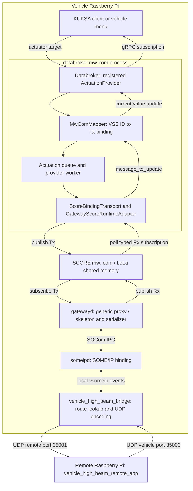

# Demo Architecture

[Back to the operator guide](README.md)

## Contents

- [Process and signal flow](#process-and-signal-flow)
- [Horn actuation and feedback](#horn-actuation-and-feedback)
- [Identifiers](#identifiers)
- [Serialization](#serialization)
- [Speed and acknowledgements](#speed-and-acknowledgements)
- [Configuration and packaging](#configuration-and-packaging)
- [Dependency history](#dependency-history)
- [Standalone BCM profile](#standalone-bcm-profile)

## Process and Signal Flow

The default `combined` profile runs the vehicle stack on one Raspberry Pi without VMs. `databroker-mw-com` contains both the broker and its mw::com provider. The provider has a worker thread with its own async runtime, not a separate process or a localhost gRPC provider connection. External clients reach the broker through KUKSA gRPC.



The remote app handles UDP directly. There is no remote bridge or remote `someipd` process. In `direct` command mode the legacy vehicle app publishes the body Tx instance instead of KUKSA. Never offer the same Tx instance from two publishers.

## Horn Actuation and Feedback

Request `Vehicle.Body.Horn.IsActive = true` through an actuator-target API. Writing only the current datapoint is not outbound actuation.

1. The broker calls `QueuedActuationProvider::actuate()`.
2. `MwComMapper::actuation_to_message()` selects `actuation_binding`, not the feedback binding, and creates an `MwComMessage` with `/body_control_module_tx`, `local_tx`, `horn_state`, and `MwComValue::Bool(true)`.
3. The callback queues the message. The worker calls `ScoreBindingTransport::send_actuation()` and resolves the service/instance/member against generated metadata.
4. `GatewayScoreRuntimeAdapter` publishes a `HighBeamCommand` sample using the `HighBeamTxInterface` producer on `/body_control_module/local_tx`. LoLa supplies discovery, publisher/subscriber APIs, and shared-memory sample storage.
5. `gatewayd` consumes `horn_state` through a generic proxy and serializes it to one payload byte, `0x01`.
6. `gatewayd` passes the event through SOCom IPC to `someipd`, which delivers a local SOME/IP event to the bridge.
7. The bridge matches the numeric event to a route and sends its UDP frame to the remote app.

Return traffic follows the reverse transport path. `gatewayd` deserializes and publishes the Rx sample on `/body_control_module/network_rx`. The provider polls typed subscriptions and uses `message_to_update()` to check direction, datatype, quality, age, and configured bounds before updating the broker's current value.

**Queued dispatch, received application feedback, and physical actuation are different outcomes.** API acceptance proves only queueing. Bridge reception does not prove remote delivery. UDP is best-effort, and a matching returned value is not a uniquely correlated acknowledgement or proof of a physical actuator operating.

Provider implementation files belong to the separately supplied `kuksa-databroker` checkout: `mw_com_provider/src/provider.rs`, `mapper.rs`, `score_bindings.rs`, `gateway_adapter.rs`, and `gateway_samples.rs`. That checkout is not included in this repository snapshot.

## Identifiers

Names and IDs belong to different layers and are mapped explicitly, not derived from Rust type names.

| Layer | Horn command | Horn feedback |
| --- | --- | --- |
| VSS path | `Vehicle.Body.Horn.IsActive` | Same path, current value |
| Provider signal ID | `2` | `2` |
| Provider service / instance | `/body_control_module_tx` / `local_tx` | `/body_control_module_rx` / `network_rx` |
| LoLa instance specifier | `/body_control_module/local_tx` | `/body_control_module/network_rx` |
| Event member | `horn_state` | `horn_state` |
| LoLa event ID | `2119` | `2120` |
| SOME/IP service ID | `0x4300` (17152) | `0x4300` (17152) |
| SOME/IP instance ID | `0x1000` (4096) | `0x1001` (4097) |
| SOME/IP event / eventgroup ID | `0x8434` (33844) | `0x8435` (33845) |
| Wire payload | One byte, `0` or `1` | One byte, `0` or `1` |

See the [provider mappings](sdv-hack-demo/config/gateway_provider_config.json), [LoLa manifest](inc_someip_gateway/score/gatewayd/etc/mw_com_config.json), [gateway config](sdv-hack-demo/config/mw_someip_config.json), and [routes](sdv-hack-demo/signal_routes.json). High-beam retains event pair `0x8430/0x8431`; other body events use pairs `0x8434/0x8435` through `0x8488/0x8489`.

`local_service_instances` selects local LoLa offers to forward outward. `remote_service_instances` selects incoming network services to expose locally through generic skeletons. SOME/IP carries numeric IDs, not the text `body_control_module_tx`.

## Serialization

All body Tx events use `PreSerializedData<N>`. Rx booleans use native `bool` and `BooleanSerializerConfig`; other body Rx types use `PreSerializedData<N>` and `NullSerializerConfig`.

| Datatype | Wire payload | N |
| --- | --- | --- |
| `boolean` | One byte, `0` or `1` | 1 |
| `uint8` | One unsigned byte; percentage values use 0-100 | 1 |
| `int16` | Two-byte signed integer, big-endian | 2 |
| `float` | IEEE-754 float32, big-endian | 4 |
| `float_array` | Packed float32 values, big-endian; up to eight values | 32 |
| `string` | UTF-8 without a terminating NUL | 32 |

The bridge forwards payload bytes unchanged. The 32-byte UDP payload bounds float arrays to eight elements. A native horn sample occupies 32 bytes including metadata/alignment; only its one-byte value goes over the network. The BCM naming migration preserves event IDs and wire payloads, not the standalone BCM typed model.

The gateway keys SOCom connectors by service type name, so one type must not have both local and remote instances. The demo uses separate types per direction: `body_control_module_tx`/`body_control_module_rx` and `vehicle::VehicleDynamicsService`/`vehicle::VehicleDynamicsService_rx`. Both dynamics types retain SOME/IP service ID `6433`.

The [serializer shim](sdv-hack-demo/serializer/serializer_shim.cpp) maps the speed `..._rx` service name to the original name and forwards calls to the gateway serializer. Packaging ships the shim as `score_com_serializer.so` and the base as `score_com_serializer_base.so`. Both must remain in the vehicle directory, which the launcher prepends to `LD_LIBRARY_PATH`.

## Speed and Acknowledgements

The [vehicle-dynamics example](communication/score/mw/com/example/vehicle-dynamics-example/BUILD) supplies shared API definitions and build/link dependencies. Its [generated C++ interface](communication/score/mw/com/example/vehicle-dynamics-example/com-api-gen/vehicle_gen.h) declares `HighBeamTx`, `VehicleHighBeamRx`, and `VehicleDynamicsService`. Building those dependencies does not run the standalone Rust example inside the Databroker.

Outgoing speed uses `/Vehicle/Service1/Instance`; incoming speed uses `/Vehicle/Service2/Instance`. The read-only `Vehicle.Speed` mapping uses `GatewaySubscription::Speed` and a typed `Subscription<SpeedSample>`, decoding the `f64` value and quality. Its nine-byte wire payload is a big-endian double plus a quality byte (currently `3`); the native sample occupies 16 bytes. This is not a generic body float payload.

The dynamics service defines `speed` and `speedAck`. The remote echoes a vehicle speed on `speedAck`, and remote menu option `2` sends a remote-entered value on that same event. The vehicle cannot distinguish those sources. A genuinely independent remote-originated speed requires a third event and coordinated changes to routes, LoLa, and gateway configs.

## Configuration and Packaging

| File | Responsibility |
| --- | --- |
| [Body manifest](sdv-hack-demo/config/body_signals.json) | Source of truth for 44 body, door, and powertrain signals |
| [Synchronizer](sdv-hack-demo/configure_signals.py) | Updates gateway/LoLa/vsomeip configs, routes, and C++ declarations |
| [Provider generator](sdv-hack-demo/gateway_provider_codegen.py) | Generates mappings and Rust gateway interfaces/metadata, including speed |
| [Gateway config](sdv-hack-demo/config/mw_someip_config.json) | Demo service types, instances, and serializers |
| [vsomeip config](inc_someip_gateway/tests/integration/vsomeip-gateway-services.json) | Routing, applications, and eventgroups |
| [Bridge](sdv-hack-demo/bridge/main.cpp) | Local SOME/IP-to-UDP relay in both directions |
| [Remote app](sdv-hack-demo/remote_app/main.cpp) | UDP state source/sink, menu, GPIO, and feedback |
| [Vehicle launcher](sdv-hack-demo/deploy/start-vehicle.sh) | Starts gateway daemons, bridge, and selected vehicle profile |
| [Remote launcher](sdv-hack-demo/deploy/start-remote.sh) | Starts the remote UDP app |
| [Packaging script](sdv-hack-demo/package-aarch64.sh) | Collects matching binaries, configs, runfiles, and launchers |

The provider generator also refreshes `mw_com_provider/generated/gateway_bindings.rs` and `gateway_runtime.rs` in the required KUKSA checkout. Its composition entry point is `databroker-mw-com/src/main.rs`. Gateway-compatible mappings must use the matching gateway adapter and LoLa manifest, not the standalone `BodyControlModuleService` profile's different names and native sample layouts.

Packaging selects `bazel-out/aarch64-fastbuild/bin` in both Bazel workspaces instead of relying on the latest `bazel-bin` symlink. It compiles the demo gateway JSON as `mw_someip_config.bin` and ships a matching `mw_com_config.json`; the gateway's generic window-control/echo config is not used.

The vehicle archive includes gateway daemons/runfiles, bridge, broker/CLI, provider config, vehicle app/runfiles, serializers, and launchers. It excludes the separate `kuksa_high_beam_udp_provider`. The remote archive contains the remote app/runfiles and launch/configuration files. Regenerate, rebuild, package, and redeploy both archives together after signal-contract changes.

The vehicle launcher waits for gateway receive shared memory before KUKSA startup, budgets about two minutes for broker readiness, and stops stale KUKSA retry loops before checking port `55555`. It detects dead gateway daemons and retries a stuck gateway IPC handshake. Provider subscription retries reuse the existing LoLa runtime and Tx offer rather than creating a second skeleton.

## Dependency History

The original integration baseline is upstream `eclipse-score/inc_someip_gateway` `main`, commit `32624b21`, plus integration changes: speed/boolean serializer and schema support, `eventgroup_ids` handling and tracing in `someipd`, and the empty-handle guard, proxy-creation retry, and `App->SOME/IP` tracing in `gatewayd`. Treat this as integration history, not a substitute for checking the current checkout.

The integration deliberately keeps `score_communication` at `0.3.0` and `score_baselibs` at `0.2.12` in [inc_someip_gateway/MODULE.bazel](inc_someip_gateway/MODULE.bazel), because upgrading the gateway alone changes the LoLa runtime also linked by KUKSA through `communication/`. The mw::com IPC binding target `//score/gateway_ipc_binding:gateway_ipc_binding_mw_com` and its aggregate test are disabled through `target_compatible_with`. Re-enable only after upgrading communication and gateway together and revalidating the complete flow.

The `--config=sdv-demo` build configuration compiles legacy host C dependencies as GNU C11, avoiding GLib `bool` field conflicts with GCC 15's C23 default without passing C-only flags to C++ compilation.

## Standalone BCM Profile

[start-body-control.sh](sdv-hack-demo/deploy/start-body-control.sh) is an isolated alternative packaged as `body-control-aarch64.tar.gz`. It starts the broker/provider with the standalone BCM provider config and LoLa manifest, plus `body-control-module-example`. It does not start gatewayd, someipd, or the bridge, and is not required for the gateway demo. The generic communication inter-domain gateway is also outside this launcher.

Extract that archive to `~/body-control-demo` and start it independently. Do not mix its config with the gateway vehicle archive.

**BCM Pi, working directory: any directory:**

```bash
~/body-control-demo/run/start-body-control.sh
```

**BCM Pi, second terminal, working directory: `~/body-control-demo`:**

```bash
cd ~/body-control-demo
./databroker-cli get Vehicle.Speed
./databroker-cli actuate Vehicle.Body.Horn.IsActive true
```