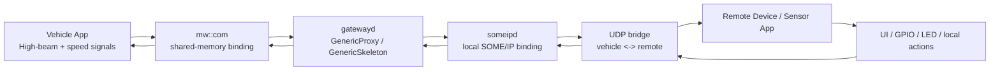
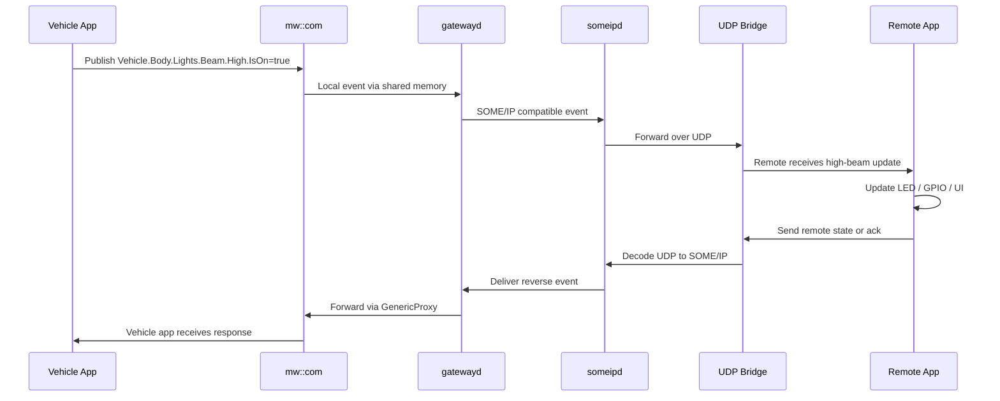

# SDV Blueprint Proposal: Hackathon-in-a-Box

## Overview

We propose a new Eclipse SDV Blueprint named "Hackathon-in-a-Box" to enable local communities, meetup organizers, and Eclipse SDV member teams to quickly set up and run Software Defined Vehicle (SDV) themed hackathons with minimal effort and a consistent technical baseline.

The goal is to provide a lightweight, reusable, and easy-to-start environment that allows participants to explore SDV concepts, build small applications around vehicle communication, and validate ideas in a realistic but approachable setup. The initiative is intentionally designed to be modular, low-friction, and easy to adapt for both educational meetups and larger technology or fair demonstrations.

This blueprint should serve as a practical foundation for:

- local community meetups
- university or regional SDV workshops
- community-organized hackathons
- member-led demo events
- contributions to larger fairs and technology showcases within Eclipse SDV

## Motivation

The SDV ecosystem continues to grow, but hands-on access to realistic examples remains one of the biggest barriers for new contributors, students, and local communities. Many groups want to organize technical events, but they often lack:

- a ready-to-use SDV environment
- simple demo hardware or virtual vehicle setups
- onboarding guidance for non-experts
- a curated set of sample applications and tasks
- a reproducible architecture that can be adapted by different organizations

A "Hackathon-in-a-Box" blueprint addresses this gap by packaging the essential ingredients needed to run a successful SDV-focused event: a working reference architecture, example apps, communication patterns, demonstration flows, and a straightforward setup process.

## Intent and Goals

The intent of this blueprint is to make SDV experimentation approachable, collaborative, and scalable.

### Primary goals

- Provide a ready-to-run SDV hackathon stack that can be started quickly
- Lower the barrier for local communities and meetup organizers
- Support community-organized, hands-on events without requiring a large upfront investment
- Enable participants to learn SDV core concepts through realistic use cases
- Create reusable demo components that can be integrated into fair and technology showcases
- Encourage collaboration between Eclipse SDV members and the broader ecosystem

## Scope

This blueprint will include:

- a small reference SDV architecture for vehicle-oriented applications
- communication between vehicle-side and remote-side components
- example signal/message flows and app logic
- a simplified demo environment that can run locally and be adapted to various setups
- a lightweight onboarding path for participants and event organizers
- examples for hackathon tasks, challenge ideas, and demo scenarios
- documentation for setup, execution, and customization

The blueprint should be designed so it can be used both as:

- a standalone local meetup package
- a reusable demonstrator for member showcases and fairs

## Proposed Use Cases

This blueprint is intended to support a broad range of scenarios, including:

### 1. Local Meetup Support

- Short workshops with a technical introduction to SDV concepts
- Hands-on exercises around in-vehicle communication and app logic
- Easy onboarding for developers, students, and open-source contributors

### 2. Community Hackathons

- Short challenge tracks such as vehicle signal handling, remote control, edge logic, telemetry, or app integration
- Participants can build on a common SDV reference implementation without requiring a deep initial setup
- Teams can iterate quickly and showcase their results in a standard environment

### 3. Eclipse SDV Member Demonstrations

- Reuse the blueprint as a building block in larger fair demonstrations
- Present a modular, realistic SDV system as part of events, exhibitions, or member showcases
- Combine the blueprint with other SDV technologies and use cases

### 4. Technology Demos and Community Events

- Provide a compact, understandable SDV scenario for visitors and decision-makers
- Present the ecosystem in a concrete, practical, and interactive form

## Technical Concept

The blueprint will focus on a practical, illustrative SDV setup rather than a full production stack. The design should reflect a realistic architecture without requiring heavy infrastructure or complex hardware dependencies.

### Core elements may include

- a vehicle application or simulated vehicle logic
- a remote/control application
- a bridge or protocol layer for communication
- serialized or structured message exchange
- example tasks around data processing and causality
- a simple deployment and run flow

This approach keeps the system understandable for participants while still demonstrating important SDV concepts such as:

- communication between vehicle domains
- remote interaction and control
- data-oriented application patterns
- modular architecture and deployment flexibility
- realistic integration challenges

## Reference Architecture

The blueprint is built around a minimal but realistic SDV communication flow that can be explained clearly to participants and reproduced by organizers with a small number of devices.



### Component roles

- Vehicle application: publishes high-beam state and speed values from the vehicle side; subscribes to reverse-flow updates from the remote side.
- mw::com shared-memory layer: provides a local, service-oriented communication layer between the vehicle logic and gateway components.
- gatewayd: acts as the translation and routing component between local vehicle service interfaces and the SOME/IP network boundary.
- someipd: owns the local SOME/IP binding and exposes the service interactions required for vehicle communication.
- Bridge: converts vehicle-side SOME/IP events to UDP and converts remote UDP frames back into SOME/IP events for local consumption.
- Remote app: receives the state from the vehicle, optionally exposes a sensor or UI input, and sends state updates back over the network.

This architecture demonstrates how a connected vehicle can expose data to a remote edge or developer environment while preserving a service-oriented model and keeping the demo easy to understand.

## Demo Description

The reference demo for the blueprint centers on a bidirectional high-beam signal and a simple vehicle dynamics interaction. The primary signal is:

```text
Vehicle.Body.Lights.Beam.High.IsOn
```

The demo can also carry related vehicle-dynamics signals such as:

```text
Vehicle.speed
Vehicle.speedAck
```

### Forward flow: vehicle to remote

The demo starts with the vehicle app publishing a high-beam value, such as true or false. This value enters the local mw::com service layer through a shared-memory-based GenericSkeleton pattern and is forwarded to gatewayd. The gateway converts the local publish into a SOME/IP-compatible event, which is delivered through someipd and then transmitted through the bridge over UDP to the remote device.

On the remote side, the app decodes the payload and exposes the state to a simple sensor or UI representation. In practice, the remote side can drive a GPIO-backed LED or present the state in a local menu, giving participants a concrete, visual demonstration of a vehicle signal crossing the network boundary.

### Reverse flow: remote to vehicle

The remote application can also publish its own state back to the vehicle. This may be triggered from a button input, sensor update, or a menu command. The remote app encodes the state as a UDP payload, which is received by the bridge, translated back to a SOME/IP event, and delivered through someipd and gatewayd back into the local vehicle application via the mw::com GenericProxy layer.

This two-way interaction makes the demo useful for hackathon exercises: participants can observe a signal move from a local vehicle app to a remote environment and then back again, reinforcing key concepts around signal routing, serialization, protocol conversion, and event-driven integration.

### Example event flow



### Why this is a good hackathon blueprint

This demo is intentionally compact but realistic. It allows participants to work with:

- service-oriented vehicle communication
- event forwarding between local and remote systems
- protocol bridging across network boundaries
- simple deployment on Raspberry Pi or similar edge devices
- hands-on interaction with real signal updates and acknowledgement flow

It is simple enough for local meetup organizers and community teams to reproduce, while still demonstrating the kind of architecture and integration patterns that matter in SDV systems.

## Ease of Start

A key requirement of this blueprint is that it must be easy to start and easy to maintain. The target is a setup that can be launched by a local organizer or member team without extensive custom engineering.

This means:

- a clear quick-start flow
- minimal prerequisites
- modular documentation
- standard examples and challenge templates
- reproducible build and run instructions
- simple adaptation for different host environments

## Eclipse Projects and Technologies Used

This blueprint is designed to demonstrate how Eclipse SDV technologies can be combined in a compact, practical, and community-friendly setup. The initial implementation and reference architecture are aligned with the following Eclipse projects and technology areas:

- Eclipse S-CORE: used for the service-oriented communication and middleware patterns, including mw::com-based local interaction and gateway communication.
- Eclipse KUKSA: used for vehicle data access, vehicle state representation, and example actuator flows around real SDV signals.
- Eclipse AutoSD: used as a relevant SDV ecosystem building block for vehicle data and service-oriented application patterns.
- Eclipse AutoWRX: used as a reference for runtime and communication-oriented integration concepts suitable for experimental demo environments.
- Other relevant Eclipse SDV ecosystem components may be integrated over time as examples, challenge tracks, or demo extensions.

The blueprint is intentionally not limited to a single technology stack. Instead, it demonstrates how a simple local event can combine several Eclipse SDV building blocks into an accessible, easy-to-run experience for meetup organizers and community contributors.

## Relationship to SDV Blueprints

This proposal aligns well with the goals of the Eclipse SDV Blueprints initiative:

- it demonstrates practical SDV value
- it can be reused by the community
- it supports education and experimentation
- it reduces barrier-to-entry for new participants
- it can be extended by multiple organizations and contributors

It should be designed as an open, collaborative blueprint that can evolve with community needs, while remaining lightweight enough to be adopted by local meetup organizers and demonstration teams.

## Expected Value

This blueprint will help the Eclipse SDV community in multiple ways:

- lower the barrier for hands-on learning
- encourage more local and regional SDV engagement
- support community-led innovation and prototyping
- provide a reusable demo building block for member-led fairs and technical showcases
- create a common entry point for new contributors and event organizers

## Proposed Deliverables

The initial blueprint contribution should include:

- a documented architecture overview
- reusable demo code and example applications
- quick-start instructions
- sample challenge ideas for hackathons
- configuration examples and deployment scripts
- a simple communication pattern suitable for local events
- guidance for integrating into larger technology demonstrations

## Maintenance and Community Participation

This blueprint should be maintained as an open, community-driven contribution. Initial committers and maintainers will be expected to:

- keep the quick-start flow working
- review and improve event documentation
- contribute example scenarios and tasks
- help adapt the blueprint for different communities and event types
- support integration into fairs and member demos

## Conclusion

We propose the creation of a new Eclipse SDV Blueprint called "Hackathon-in-a-Box" to make SDV experimentation more accessible, more community-driven, and more reusable for real-world events.

The blueprint is intended to support local meetups, community-organized hackathons, and demonstration activities while also serving as a building block for fair and technology showcases by Eclipse SDV members. By creating a simple, modular, and easy-to-start SDV reference environment, we can lower the barrier to participation and foster broader engagement across the ecosystem.

---

## Suggested Issue / Proposal Text

### Title
Hackathon-in-a-Box: an easy-to-start SDV blueprint for local meetups, community hackathons, and member demos

### Short description
We propose a new blueprint called "Hackathon-in-a-Box" to support local meetups and community-organized hackathons with a simple, reproducible SDV environment. The initiative is also intended to serve as a reusable building block for fair demonstrations and technology showcases by Eclipse SDV members.

### Proposed intent
The blueprint will provide a lightweight, easy-to-start SDV demo environment that helps participants learn SDV concepts, experiment with realistic communication patterns, and develop simple applications in a hands-on format. It is designed to be useful for community events, meetup organizers, members, and demonstration teams without requiring complex setup or hardware dependencies.
