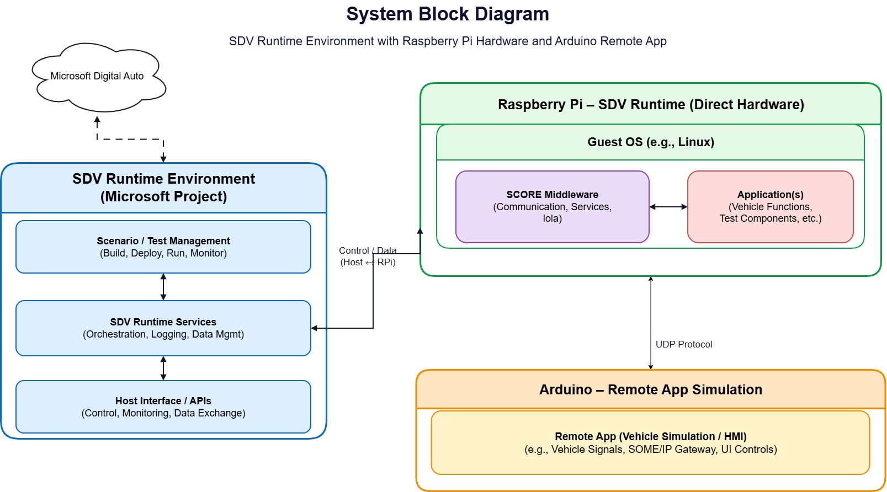
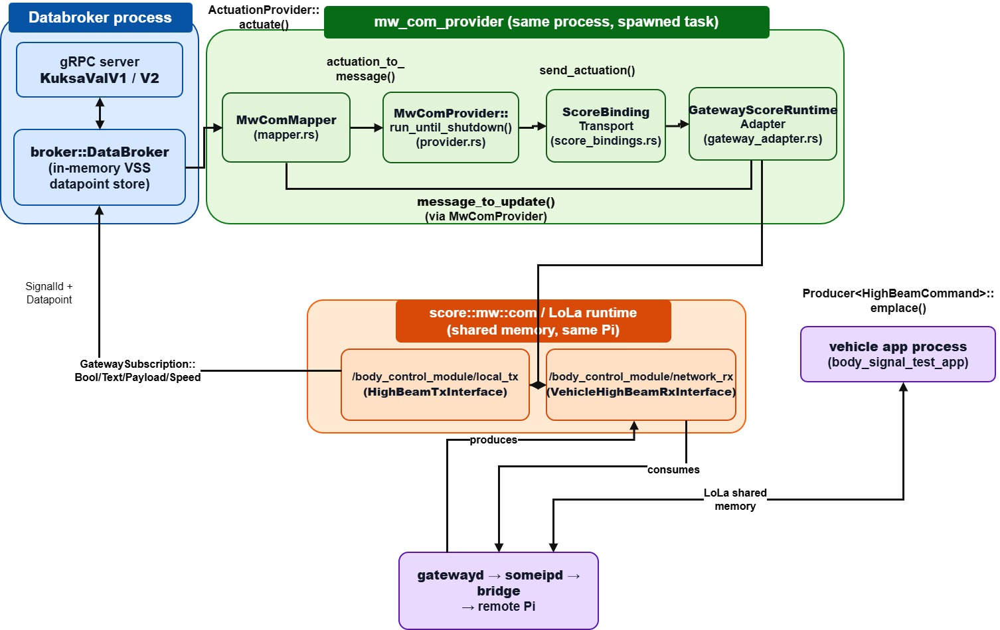
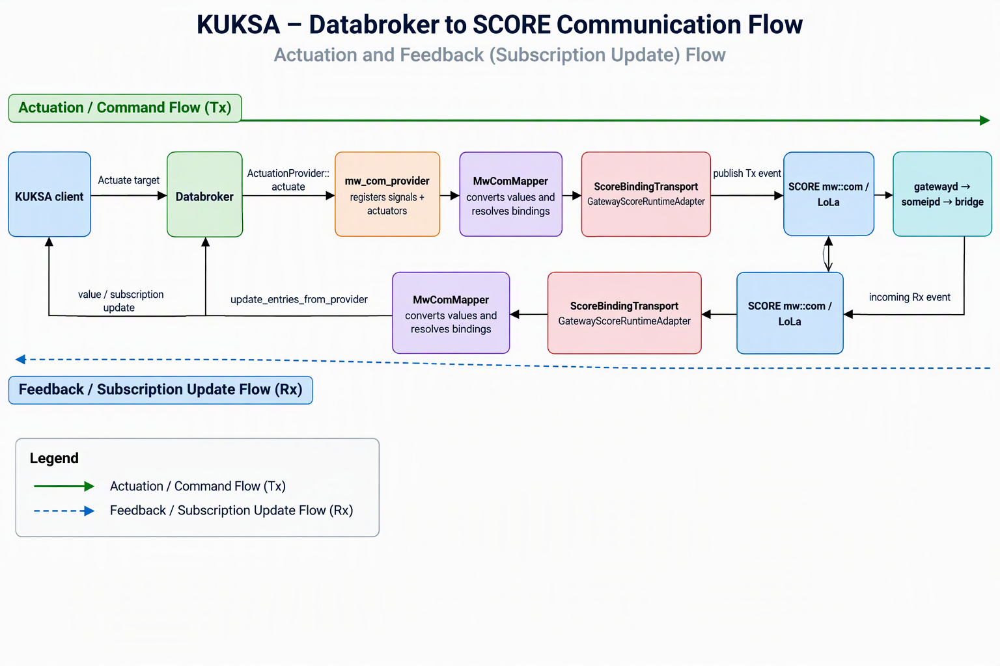

# sdv-hackathon-in-a-box

## Overview

This demo exchanges VSS signals between two Raspberry Pis. The vehicle Pi runs KUKSA Databroker, Eclipse S-CORE mw::com shared memory, a SOME/IP gateway, and a UDP bridge. The remote Pi runs a UDP application with a keyboard menu, GPIO switch, and LED.

The vehicle application provides a menu for high-beam commands and speed values. By default, high-beam commands use KUKSA VAL v2 actuation, and the KUKSA provider is the sole body-signal mw::com Tx publisher. The remote reports application state back to the vehicle. **A queued command, returned application feedback, and physical actuator operation are not equivalent.** UDP delivery is best-effort.

## Contents

- [Quick start](#quick-start)
- [Prerequisites](#prerequisites)
- [Operating modes](#operating-modes)
- [Network configuration](#network-configuration)
- [Menus and verification](#menus-and-verification)
- [GPIO wiring and safety](#gpio-wiring-and-safety)
- [Test all 44 signals](#test-all-44-signals)
- [Signals and configuration](#signals-and-configuration)
- [Logs and troubleshooting](#logs-and-troubleshooting)
- [Stop the demo](#stop-the-demo)
- [Architecture](#architecture)
- [Project files](#project-files)

## Quick Start

Use an isolated test rig. Complete the [prerequisites](#prerequisites) first; the build requires the full workspace, a configured ARM64 toolchain, and the separately supplied KUKSA integration checkout. Example addresses are vehicle `10.56.121.101` and remote `10.56.121.79`. Replace `<user>` with the SSH account on each Pi.

### 1. Build

**Build host, working directory: repository root:**

```bash
cd sdv-hack-demo
bash build-aarch64.sh
bash package-aarch64.sh
```

Outputs in `sdv-hack-demo/dist/` are `vehicle-aarch64.tar.gz`, `remote-aarch64.tar.gz`, and the separate `body-control-aarch64.tar.gz`. The first two archives are self-contained for Pi runtime; no Bazel or cross-toolchain is needed on the Pis. Rebuild and redeploy matching archives after changing binaries or the signal contract.

### 2. Deploy

For an existing deployment, [stop both devices](#stop-the-demo) before replacing files. Back up `network.env` and any state you need; the extraction commands below delete the old deployment, including saved remote state.

**Build host, working directory: `sdv-hack-demo`:**

```bash
scp dist/vehicle-aarch64.tar.gz <user>@10.56.121.101:/tmp/
scp dist/remote-aarch64.tar.gz <user>@10.56.121.79:/tmp/
```

Enter SSH passwords directly in the terminal when prompted.

**Vehicle Pi, working directory: any directory:**

```bash
rm -rf ~/sdv-demo
mkdir -p ~/sdv-demo
tar -xzf /tmp/vehicle-aarch64.tar.gz -C ~/sdv-demo
```

**Remote Pi, working directory: any directory:**

```bash
rm -rf ~/sdv-demo
mkdir -p ~/sdv-demo
tar -xzf /tmp/remote-aarch64.tar.gz -C ~/sdv-demo
```

Check [network configuration](#network-configuration) on both Pis before starting. Read the [GPIO safety instructions](#gpio-wiring-and-safety) before connecting hardware.

### 3. Run

**Remote Pi, working directory: any directory, foreground terminal:**

```bash
~/sdv-demo/run/start-remote.sh
```

**Vehicle Pi, working directory: any directory, separate foreground terminal:**

```bash
~/sdv-demo/run/start-vehicle.sh
```

The default mode starts someipd, gatewayd, the bridge, and KUKSA in the background, then the vehicle menu in the foreground. Allow about two minutes for broker readiness. The remote app handles UDP directly; no remote gateway or SOME/IP daemon is started.

### 4. Verify

On the remote menu, select `3` and enter `true`, then `false`. Parking lights are software state only; no GPIO is assigned to them.

**Vehicle Pi, second terminal, working directory: `~/sdv-demo`:**

```bash
cd ~/sdv-demo
./databroker-cli --server http://127.0.0.1:55555 get Vehicle.Body.Lights.Parking.IsOn
```

The current value should follow the remote selection. This checks application feedback, not physical actuation. For outbound high beam, use vehicle menu option `1`; verify remote reception, LED output where available, and returned current value separately. See [menus and verification](#menus-and-verification).

### 5. Stop

Use `q` to exit each foreground app, then follow [Stop the demo](#stop-the-demo) to stop the background processes. Quitting the vehicle menu alone is not a complete stack shutdown.

## Prerequisites

### Build Host

- Linux x86_64, Bazel/Bazelisk, Python 3, SSH, and `scp`.
- The full repository workspace, including `communication/` and `inc_someip_gateway/`, not just the demo folder.
- ARM64 Bazel configuration `aarch64-linux` and the configured cross-toolchain, normally at `$HOME/aarch64_toolchain`.
- The matching KUKSA integration checkout at `kuksa-databroker/` in the repository root, including `scripts/build-rpi-aarch64.sh`, the mw::com provider, and composition binary. This checkout is absent from this repository snapshot; obtain the matching integration sources before building. An arbitrary upstream KUKSA checkout is not a documented replacement.
- Network access to both Pis.

The [build script](sdv-hack-demo/build-aarch64.sh) regenerates configs, builds both gateway daemons and demo targets, then invokes the KUKSA ARM64 build. [Dependency compatibility and serializer details](ARCHITECTURE.md) are documented separately.

### Raspberry Pis

Both devices require a 64-bit Linux distribution and SSH access.

**Both Pis, working directory: any directory:**

```bash
uname -m
sudo apt update
sudo apt install -y rsync openssh-server ca-certificates libstdc++6 libgcc-s1 libc6 libatomic1 iproute2 procps util-linux
sudo systemctl enable --now ssh
```

`uname -m` must report `aarch64`. The launcher uses tools such as `ss`, `pgrep`, and `flock`. The cross-toolchain stays on the build host.

## Operating Modes

`direct` is a command-routing setting within `combined`, not a value of `VEHICLE_APP_MODE`.

| Mode | Environment settings | Processes and body Tx owner |
| --- | --- | --- |
| `combined` (default) | `VEHICLE_APP_MODE=combined HIGH_BEAM_COMMAND_MODE=kuksa` | Gateway, bridge, KUKSA, vehicle menu; KUKSA owns body Tx |
| `direct` | `VEHICLE_APP_MODE=combined HIGH_BEAM_COMMAND_MODE=direct` | Same processes; legacy vehicle app owns body Tx; KUKSA body mappings become read-only |
| `signals` | `VEHICLE_APP_MODE=signals` | Gateway, bridge, all-signal tester; no KUKSA or regular vehicle menu; tester owns body Tx |

Never run two publishers for `/body_control_module/local_tx`. Stop the current stack before switching modes. Keep the remote app running for round-trip testing.

**Vehicle Pi, working directory: any directory, alternative direct launch:**

```bash
VEHICLE_APP_MODE=combined HIGH_BEAM_COMMAND_MODE=direct ~/sdv-demo/run/start-vehicle.sh
```

KUKSA commands must use VAL v2 `Actuate` or Velocitas VDB `SetDatapoints`. Writing a VAL v1 current value is not an actuator command. Default vehicle menu commands use `VDB_ADDRESS=127.0.0.1:55555`.

## Network Configuration

Both archives include `~/sdv-demo/network.env`. Set matching addresses on both devices after deployment or an IP change.

**Both Pis, working directory: any directory:**

```bash
nano ~/sdv-demo/network.env
```

Contents of `network.env` on both Pis (configuration, not a separate command):

```bash
export HIGH_BEAM_VEHICLE_IP=10.56.121.101
export HIGH_BEAM_REMOTE_IP=10.56.121.79
export HIGH_BEAM_BRIDGE_UDP_PORT=35000
export HIGH_BEAM_REMOTE_UDP_PORT=35001
```

The remote listens on UDP `35001` and sends feedback to vehicle UDP `35000`. The launchers prevent duplicate instances with locks and reject occupied default UDP ports. Use the launchers rather than manually starting a second stack.

## Menus and Verification

### Vehicle Menu

Vehicle Pi, foreground application menu:

```text
1   Select high-beam and enter true or false
2   Select speed and enter a numeric value
q   Quit
```

Bare `true` and `false` also select high beam. In default combined mode these requests go through KUKSA, which queues outbound actuation. Acceptance is not remote-output acknowledgement.

### Remote Menu

Remote Pi, foreground application menu:

```text
1   High-beam (true/false)
2   Send speed on the Vehicle.speedAck return channel
3   Vehicle.Body.Lights.Parking.IsOn (true/false)
4   Publish test values for all 44 body signals
q   Quit remote app
```

The menu is available while GPIO monitoring and command reception run in background workers. High beam is reported every two seconds. Parking-light state is published immediately and repeated every two seconds after its first menu value or vehicle command; no initial parking-light state is published before that.

Option `4` is a publish sweep, not an acknowledgement test. It sends false/true/false for booleans, 0/50/100/0 for percentages, and OFF/FAST/OFF for strings, with five seconds between values. Use normal combined mode to observe KUKSA current values. Use only an isolated rig; this publishes horn, lock, lighting, window, and wiper values.

### Expected Results

For a default vehicle high-beam command, distinguish these stages. Example output across vehicle and remote terminals/logs:

```text
Vehicle menu requested High.IsOn=1 through KUKSA
KUKSA accepted vehicle command High.IsOn=1 (not remote output acknowledgement)
Command transmitted through mw::com Tx service=/body_control_module_tx value=Bool(true)
Remote received vehicle-side command High.IsOn=1
Remote GPIO output applied High.IsOn=1 line=27
```

The GPIO line requires accessible hardware. If GPIO cannot be opened, the app logs the error but the menu and network commands continue. Returned application state updates the broker's current value; inspect the LED separately to verify its output. Neither software feedback nor a GPIO write proves a real vehicle actuator operated.

Vehicle speed menu option `2` sends a value that the remote echoes on `Vehicle.speedAck`. Entering `12345` in remote option `2` uses that same return channel; the vehicle prints `Vehicle app received Vehicle.speedAck = 12345.000000`. Echoed and remote-entered values are indistinguishable on this event. See [speed and acknowledgements](ARCHITECTURE.md#speed-and-acknowledgements).

## GPIO Wiring and Safety

The remote app has no separate hardware/software mode. It always attempts to read BCM GPIO 17 and drive BCM GPIO 27.

- Connect a momentary switch between GPIO 17 (physical pin 11) and GND, such as physical pin 6. The internal pull-up makes pressed `true` and released `false`; changes are debounced and reported immediately.
- Connect GPIO 27 (physical pin 13) through a 330-1000 ohm resistor and LED to GND, with LED cathode to GND. Output is active-high.
- **Do not connect 5 V to GPIO. Do not connect a headlight, motor, or relay coil directly to GPIO. Input and output must not share a GPIO line.**
- The saved high-beam state is restored at startup; the LED may turn on immediately. The idle switch does not overwrite that restored state.
- Normal exit, Ctrl-C, or SIGTERM sets the output OFF. **SIGKILL cannot perform GPIO cleanup.**

GPIO 17, the menu, and vehicle commands update one shared high-beam state. Changes drive the LED, save the state, and report it back; repeated values do nothing. No parking-light GPIO is configured.

The app detects Pi pin controllers, including `pinctrl-rp1`. For permission errors, grant the runtime user access to the relevant GPIO device. Override input selection with `HIGH_BEAM_GPIO_CHIP` / `HIGH_BEAM_GPIO_LINE`, and output with `HIGH_BEAM_GPIO_OUTPUT_CHIP` / `HIGH_BEAM_GPIO_OUTPUT_LINE`.

## Test All 44 Signals

Use only an isolated rig. The sweep sends horn, lighting, lock, window, wiper, and powertrain values and does not restore previous state if interrupted. Rebuild/redeploy both matching archives first. Start the remote using the [quick start](#3-run), then launch the tester instead of combined mode. Do not change the remote switch or menu during testing.

**Vehicle Pi, working directory: any directory:**

```bash
VEHICLE_APP_MODE=signals ~/sdv-demo/run/start-vehicle.sh
```

The test sends false/true/false for booleans; 0/50/100/0 for percentages; OFF/FAST/OFF for wiper mode; NORMAL/SPORT/NORMAL for transmission mode; 20/85/110/20 Celsius for oil temperature; and float/array samples for acceleration and cell voltage.

Each value requires a matching Rx value, with retransmission every 500 ms for up to 3 seconds. Discovery/subscription allows 20 seconds. To increase those limits, use this alternative launch.

**Vehicle Pi, working directory: any directory:**

```bash
VEHICLE_APP_MODE=signals ~/sdv-demo/run/start-vehicle.sh \
  --timeout-ms 5000 --startup-timeout-ms 30000
```

Example vehicle tester output:

```text
TX Vehicle.Body.Horn.IsActive=true
RX Vehicle.Body.Horn.IsActive=true
PASS Vehicle.Body.Horn.IsActive
Summary: 44/44 signals passed; 0 failed.
```

A signal passes only when every test value returns. Missing events, timeouts, or transport errors produce `FAIL` and a nonzero exit code. Subscriptions alone are not sufficient. PASS verifies matching application payloads, not physical actuation or uniquely correlated acknowledgements; periodic or delayed packets can carry the same value.

**Vehicle Pi, working directory: `~/sdv-demo`, list without publishing:**

```bash
cd ~/sdv-demo
./body_signal_test_app --routes signal_routes.json --list
```

**Build host, working directory: repository root, unit test and non-publishing check:**

```bash
bazel test --config=sdv-demo //sdv-hack-demo/vehicle_app:signal_test_values_test
bazel run --config=sdv-demo //sdv-hack-demo/vehicle_app:body_signal_test_app -- \
  --routes "$PWD/sdv-hack-demo/signal_routes.json" --list
```

## Signals and Configuration

The [body manifest](sdv-hack-demo/config/body_signals.json) is the authoritative list of the 44 body, door, and powertrain signals, datatypes, names, and event IDs. `Vehicle.Speed` is an additional read-only provider mapping. The requested `IsOpenx` spelling is normalized to `Vehicle.Cabin.Door.Row2.PassengerSide.IsOpen`.

The [routes](sdv-hack-demo/signal_routes.json) record VSS `apiName`, mw::com `eventName`, datatype, and wire IDs. Extend the signal manifest and regenerate matching artifacts rather than changing only one deployed route file.

**Build host, working directory: repository root, synchronize and check snapshots:**

```bash
python3 sdv-hack-demo/configure_signals.py --write
python3 sdv-hack-demo/configure_signals.py
python3 sdv-hack-demo/configure_signals_test.py
```

Synchronization also updates the communication vehicle-dynamics example and generated KUKSA gateway bindings. Rebuild, package, and redeploy both archives after changes. See [configuration and packaging](ARCHITECTURE.md#configuration-and-packaging) for ownership, generated files, native layouts, and wire formats.

## Logs and Troubleshooting

### Live Logs

Vehicle background logs are `~/sdv-demo/someipd.log`, `gatewayd.log`, `bridge.log`, and `kuksa.log`. Vehicle and remote menus run in their respective foreground terminals.

**Vehicle Pi, second terminal, working directory: any directory:**

```bash
tail -f ~/sdv-demo/someipd.log ~/sdv-demo/gatewayd.log ~/sdv-demo/bridge.log ~/sdv-demo/kuksa.log
```

**Vehicle Pi, second terminal, working directory: any directory, high-beam filter:**

```bash
tail -f ~/sdv-demo/someipd.log ~/sdv-demo/gatewayd.log ~/sdv-demo/bridge.log ~/sdv-demo/kuksa.log | grep --line-buffered 'High.IsOn'
```

To capture foreground output, use one of the following instead of the corresponding normal launch, not alongside an already running instance.

**Vehicle Pi, working directory: any directory:**

```bash
~/sdv-demo/run/start-vehicle.sh 2>&1 | tee ~/sdv-demo/vehicle_app.log
```

**Remote Pi, working directory: any directory:**

```bash
~/sdv-demo/run/start-remote.sh 2>&1 | tee ~/sdv-demo/remote_app.log
```

### Signal Timeouts

`Bridge converted UDP to SOME/IP` means the bridge called `notify()`, not that someipd or the subscriber received it. Look for bridge subscription ACK/NACK, someipd `Network received`, and then `Network->IPC`. Payload allocation failures are logged explicitly. A startup placeholder-event warning alone does not prove permanent failure.

**Vehicle Pi, working directory: any directory, high-beam-switch route:**

```bash
grep -E 'high_beam_switch|8436|8437' \
  ~/sdv-demo/bridge.log ~/sdv-demo/someipd.log ~/sdv-demo/gatewayd.log | tail -n 80
```

Forward event is `0x8436`; return event is `0x8437`. UDP return without `Network received` points to local SOME/IP delivery/subscription. `Network->IPC` without tester `RX` points to gateway deserialization or mw::com delivery.

Repeated `Failed to create RemoteServiceInstance` or `Dropping SOME/IP event: no IPC subscriber connected` indicates an incomplete IPC handshake. [Stop the stack](#stop-the-demo) and restart remote first, then vehicle. An `Instance id exceeds fixed size` assertion indicates an internal service/instance identifier exceeded 32 characters; fix the gateway identifier, rebuild, and redeploy matching artifacts.

### Network and Runtime Checks

**Both Pis, working directory: any directory:**

```bash
ss -lunp | grep -E ':35000|:35001' || true
ping -c 3 10.56.121.101
ping -c 3 10.56.121.79
pgrep -af 'someipd|gatewayd|vehicle_high_beam|body_signal_test_app|databroker-mw-com|start_kuksa'
```

If a firewall is active, permit UDP from the peer using your actual addresses.

**Vehicle Pi, working directory: any directory:**

```bash
sudo ufw allow from 10.56.121.79 to any port 35000 proto udp
```

**Remote Pi, working directory: any directory:**

```bash
sudo ufw allow from 10.56.121.101 to any port 35001 proto udp
```

For missing libraries, confirm extraction produced real files rather than unresolved symlinks.

**Vehicle Pi, working directory: any directory:**

```bash
find ~/sdv-demo -name 'libvsomeip3.so.3' -type f -print
find ~/sdv-demo -name 'score_com_serializer.so' -type f -print
find ~/sdv-demo -name 'score_com_serializer_base.so' -type f -print
```

## Stop the Demo

Exit foreground menus with `q` first. The launchers leave background daemons running; stop those before redeployment or changing profiles. These process-name commands are intended only for the dedicated demo Pis, not a machine hosting unrelated matching processes.

Stop the KUKSA retry launcher before its broker so it cannot respawn the broker and hold TCP port `55555`.

**Vehicle Pi, working directory: any directory, separate terminal:**

```bash
pkill -TERM -f '[s]tart_kuksa' 2>/dev/null || true
pkill -TERM -f '[s]omeipd|[g]atewayd|[v]ehicle_high_beam|[b]ody_signal_test_app|[d]atabroker-mw-com' 2>/dev/null || true
```

**Remote Pi, working directory: any directory, separate terminal:**

```bash
pkill -TERM -f '[v]ehicle_high_beam_remote_app' 2>/dev/null || true
```

Allow graceful shutdown so the remote can switch its LED OFF. Check that no matching processes remain before extracting an archive.

**Both Pis, working directory: any directory:**

```bash
pgrep -af '[s]omeipd|[g]atewayd|[v]ehicle_high_beam|[b]ody_signal_test_app|[d]atabroker-mw-com|[s]tart_kuksa'
```

If a process will not exit, identify it before using `kill -KILL <pid>`; SIGKILL cannot perform GPIO cleanup. Only after vehicle gateway processes have stopped, clear stale vsomeip locks.

**Vehicle Pi, working directory: any directory:**

```bash
rm -f /tmp/vsomeip*.lck
```

## Architecture

### System Block Diagram



### Internal Architecture



### Dataflow



See [ARCHITECTURE.md](ARCHITECTURE.md) for the canonical process/signal flow, horn IDs, serializers, speed acknowledgement semantics, dependency history, and isolated BCM profile. The default gateway profile runs entirely on the vehicle Pi; the remote app uses UDP directly.

## Project Files

| Location | Purpose |
| --- | --- |
| [Build script](sdv-hack-demo/build-aarch64.sh) | Cross-compile ARM64 gateway and application targets |
| [Packaging script](sdv-hack-demo/package-aarch64.sh) | Produce vehicle, remote, and isolated BCM archives |
| [Vehicle launcher](sdv-hack-demo/deploy/start-vehicle.sh) | Start the selected vehicle profile |
| [Remote launcher](sdv-hack-demo/deploy/start-remote.sh) | Start the remote UDP application |
| [Network defaults](sdv-hack-demo/deploy/network.env) | Packaged vehicle/remote addresses and ports |
| [Signal routes](sdv-hack-demo/signal_routes.json) | SOME/IP-to-UDP route mappings |
| [Vehicle app](sdv-hack-demo/vehicle_app) | Vehicle menu and all-signal test application |
| [Remote app](sdv-hack-demo/remote_app) | Remote menu, GPIO, UDP, and feedback |