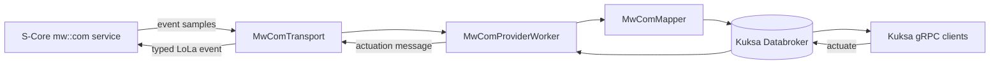

<!--
/********************************************************************************
 * Copyright (c) 2026 Contributors to the Eclipse Foundation
 *
 * See the NOTICE file(s) distributed with this work for additional
 * information regarding copyright ownership.
 *
 * This program and the accompanying materials are made available under the
 * terms of the Apache License Version 2.0 which is available at
 * https://www.apache.org/licenses/LICENSE-2.0
 *
 * SPDX-License-Identifier: Apache-2.0
 ********************************************************************************/
-->

# mw::com Provider for Kuksa Databroker

`mw_com_provider` is a Rust provider module that connects S-Core `mw::com` services to Kuksa Databroker VSS entries. It receives middleware samples, maps them to VSS datapoints, writes them into Databroker, and forwards Kuksa actuator requests back to `mw::com`.

The module is intentionally optional. Databroker core can run without it. The demo-specific provider uses an isolated patched build; see [Integration differences and build isolation](#integration-differences-and-build-isolation) before building it.

## Integration Differences And Build Isolation

The comparison baseline is the shared `kuksa-databroker_draft/kuksa-databroker` snapshot, whose Git HEAD is `4cb080eecee2ea5033d34b5f1f0f6ca2c8b76424`. It already contains the BCM provider. This checkout adapts that draft for the SDV demo:

| Area | Integration change and purpose |
| --- | --- |
| Mapping and generated artifacts | Gateway mappings, separate command bindings, `Int16` and bounded float arrays match the demo's signals and wire layouts. The mapper also translates the brake-light boolean transport to the SDK's named states; `ADAPTIVE` cannot be represented. See `src/config.rs`, `src/mapper.rs`, and `generated/`. |
| Gateway adapter | `src/gateway_adapter.rs` and `src/gateway_samples.rs` connect the provider to the demo's distinct gateway Tx/Rx services and translate their samples. |
| Composition | `databroker-mw-com/src/main.rs` chooses the gateway adapter when its mappings match, otherwise the LoLa adapter. It adds the demo's datatypes and BCM default; direct mode disables provider commands for the body Tx service to avoid two publishers. |
| Commands and feedback | `src/provider.rs` forwards only VAL v1 actuator targets or standard VAL v2 actuation callbacks. Received samples use ordinary `update_entries`; current-value publishes never become commands, so no feedback-origin extension is needed. |
| Draft API compatibility | Provider read callbacks use `&mut self`, matching the shared draft rather than the newer upstream provider trait. |
| Native linking | The Cargo shims use this workspace's S-Core checkouts. Build scripts select the body-control link parameters and merge native archives to retain registration symbols; the archive staging can be repeated with read-only inputs. |
| Verification | BCM/gateway compatibility and command/feedback tests exercise the demo-specific bindings, conversions, and forwarding. |

The checked-in `databroker/` directory is byte-for-byte identical to the shared draft, including both `src/broker.rs` and `src/grpc/kuksa_val_v2/val.rs`. No newer upstream core changes are included. The existing `databroker-proto/build.rs` change only points code generation at this checkout's shared `../proto` directory; it does not add a demo protocol.

The demo-owned [`cargo-mw-com.sh`](../../sdv-hack-demo/scripts/cargo-mw-com.sh)
only selects the KUKSA working directory and forwards Cargo arguments and exit
status. It does not patch broker sources, create modified copies, or change the
broker API. Plain Cargo builds are supported. Native builds additionally require
the S-Core dependencies below.

The runtime command writer queries metadata: actuators are written using target
values; sensors and attributes retain current-value writes. Incoming feedback
only updates current values. Updating an actuator's current value directly does
not send middleware commands. Rebuild the runtime image when upgrading the
provider; an older current-publishing runtime is not command-compatible.

The ARM64 build script invokes this plain wrapper automatically for
provider/composition builds. The root `sdv-hack-demo/scripts/build-aarch64.sh`
delegates to that script; package paths do not change. The demo runs
`databroker-mw-com`, not the separate `mw_com_provider` executable. The latter
retains its existing default-feature diagnostic stub; native standalone execution
is not validated by these demo checks.

To reproduce the demo, follow the repository's [build and deployment guide](../../README.md#build-and-package). Its signal configuration, generated provider bindings, LoLa manifests, gateway routes, and both endpoint packages must agree. Host/mock checks do not prove physical Pi-to-Pi E2E operation. See also [S-Core integration hints](docs/s-core-integration.md).

## Functional Overview

The provider owns the Databroker-facing integration and the middleware abstraction. Its main responsibilities are:

- Register configured VSS datapoints and actuators with Databroker.
- Receive S-Core `mw::com` event samples through `MwComTransport`.
- Convert middleware values into Databroker `DataValue` updates.
- Validate data type, signal direction, quality, scaling, and min/max constraints.
- Write accepted samples into Databroker using `update_entries`.
- Receive actuator requests from Databroker and publish typed S-Core LoLa events.
- Bridge Kuksa `val.v1` actuator-target writes to the same actuation path used by `val.v2` actuation callbacks.
- Reconnect and clean up middleware subscriptions if the transport fails.

The default feature set uses an in-memory mock transport. This keeps provider unit tests and provider E2E tests independent from S-Core. The `score-lola` feature enables the generated S-Core LoLa adapter and local temporary S-Core Rust crate shims.

## Architecture



The provider is split into small layers:

| Layer | Purpose |
| --- | --- |
| `provider.rs` | Databroker registration, worker loop, receive publishing, actuation queue, v1 actuator-target bridge. |
| `mapper.rs` | O(1) mapping between `mw::com` messages and Databroker updates or actuation messages. |
| `transport.rs` | Transport trait plus mock transport used by tests. |
| `score_bindings.rs` | Generated binding lookup and `ScoreRuntimeAdapter` delegation. |
| `generated/` | Generated S-Core types, interfaces, metadata, runtime config, and LoLa adapter. |
| `templates/reference-codegen/` | Templates used to regenerate the checked-in generated provider artifacts. |

## Data Flow

Inbound datapoint flow:

```text
S-Core LoLa event sample
    -> generated LolaScoreRuntimeAdapter
    -> MwComTransport::recv
    -> MwComMapper::message_to_update
    -> DataBroker::update_entries
    -> Kuksa read/subscribe clients
```

Outbound actuation flow:

```text
Kuksa val.v2 Actuate or BatchActuate
    -> Databroker ActuationProvider callback
    -> MwComMapper::actuation_to_message
    -> MwComTransport::send_actuation
    -> generated LoLa producer event
    -> S-Core application
```

Kuksa `val.v1` CLI actuation writes the actuator target field instead of calling the `val.v2` actuation callback. To keep existing CLI demos working without Databroker core changes, the provider subscribes to actuator-target updates and forwards them into the same `send_actuation` path.

The vehicle demo's `score_app` follows the same target path without connecting
to Databroker: it publishes a command on a private mw::com shared-memory
service, and the provider maps that sample to an `actuator_target` update.
Databroker's target-only subscriber then forwards it through the provider-owned
Tx producer. Remote feedback continues to update the current datapoint and is
not sent back as a command. KUKSA actuator clients remain supported.

## Optional Databroker Composition

The provider can be used in two ways:

- Embedded by an application that already owns a Databroker instance and wants to register an `MwComProviderWorker`.
- Through `databroker-mw-com`, a composition binary that starts Databroker and the provider in the same process.

`databroker-mw-com` is the recommended integration binary for the current check-in. It:

- Creates the Databroker instance.
- Seeds VSS metadata from the provider config.
- Validates generated S-Core bindings.
- Starts the provider worker using `LolaScoreRuntimeAdapter`.
- Exposes Kuksa `val.v1` and `val.v2` gRPC APIs on `127.0.0.1:55555` by default.

The binary defaults to:

```text
provider config: mw_com_provider/generated/mw_com_provider_config.json
S-Core LoLa config: mw_com_provider/generated/bcm_config_lola_config.json
address: 127.0.0.1:55555
```

## Included Files

The current package keeps the S-Core generated artifacts locally because the required generated values and scripts are not yet available from the S-Core repository. These files should move to upstream S-Core ownership once that integration exists.

| Path | Purpose |
| --- | --- |
| `src/` | Provider runtime, mapper, lifecycle, transport abstractions, and score binding integration. |
| `tests/e2e_stubbed_score.rs` | Provider E2E test using Databroker plus mock `mw::com`, without S-Core. |
| `generated/` | Generated provider config, metadata, S-Core interfaces/types, LoLa adapter, and LoLa config. |
| `models/BCM_Config.json` | Body Control Module model used to generate the provider mappings and wire types. |
| `templates/reference-codegen/` | Reference generator templates for the provider artifacts. |
| `score_com_cargo/` | Temporary Cargo manifests/shims over S-Core runtime crates. |
| `docs/s-core-integration.md` | Practical integration guide for wiring this provider to S-Core applications. |

## Build And Test

Run these commands from the Kuksa Databroker workspace root. Do not combine the default-feature standalone broker and the composition in one Cargo invocation: their TLS feature selections differ.

Format check:

```sh
cargo fmt -p mw_com_provider --check
```

Provider unit tests:

```sh
cargo test -p mw_com_provider --lib --tests
```

Provider E2E test without S-Core:

```sh
cargo test -p mw_com_provider --test e2e_stubbed_score
```

Normal provider build without S-Core:

```sh
cargo check -p mw_com_provider
```

S-Core LoLa adapter and composition binary checks:

```sh
cargo check -p mw_com_provider --features score-lola
cargo check -p databroker-mw-com
```

The S-Core checks require the local S-Core checkout and native artifacts. The build scripts auto-discover S-Core Bazel link params from the local Bazel cache when they are already available. For reproducible builds, CI, containers, or fresh developer machines, pass the artifact paths explicitly:

```sh
SCORE_COM_LINK_PARAMS=<path-to-body-control-module-example-0.params> \
SCORE_COM_BAZEL_BIN=<path-to-bazel-bin> \
cargo check -p databroker-mw-com
```

If the Bazel cache is outside the default cache location, set `SCORE_COM_BAZEL_CACHE_ROOTS` to one or more cache roots using the platform path separator.

## Development Container

The S-Core LoLa toolchain and generated native artifacts are validated with an Ubuntu 24.04 based development environment. If the host machine does not provide the required compiler, Bazel, Java, Rust, protobuf, and native library tooling, use a VS Code devcontainer for provider development.

A provider devcontainer should provide at least:

- Ubuntu 24.04 base image.
- `build-essential`, `clang`, `cmake`, `g++`, `gcc`, `gdb`, `lld`, `make`, `pkg-config`, `protobuf-compiler`, `python3`, `unzip`, and `zip`.
- OpenJDK 17 for Bazel repository rules and Java-based tooling.
- Bazelisk installed as `bazel`.
- Rust stable toolchain with `rustfmt` and `clippy`.
- CA certificates configured for both the OS trust store and the Java trust store used by Bazel.

If development happens behind a corporate TLS inspection proxy, install the corporate root certificates inside the container and run `update-ca-certificates`. Bazel also uses a JVM trust store, so configure `/etc/bazel.bazelrc` or an equivalent Bazel startup option to point Java to the updated trust store when needed.

## Regenerate Provider Artifacts

The checked-in generated files are kept until S-Core provides the generated artifacts directly. Regenerate them with:

```sh
cd mw_com_provider
bazel run //:generate_mw_com_provider_artifacts
bazel run //:verify_mw_com_provider_codegen
```

The generator reads `models/BCM_Config.json`, applies `templates/reference-codegen/`, and writes `generated/`. The BodyControl events use separate `standard_vehicle_datapoints` and `standard_vehicle_actuators` instances.

To generate from a custom model or write to a custom output directory, call `xtask` directly:

```sh
cargo run --manifest-path mw_com_provider/xtask/Cargo.toml -- codegen \
  --model /path/to/custom-model.json \
  --templates mw_com_provider/templates/reference-codegen \
  --out mw_com_provider/generated \
  --prefix mw_com
```

If the reference SCORE config code generator is not in the default relative location, pass it explicitly:

```sh
cargo run --manifest-path mw_com_provider/xtask/Cargo.toml -- codegen \
  --model /path/to/custom-model.json \
  --templates mw_com_provider/templates/reference-codegen \
  --out mw_com_provider/generated \
  --prefix mw_com \
  --codegen-root /path/to/vsps_sdk_score_config_codegen-main
```

## Complete Integration Test With S-Core

The three-terminal demo is the full integration test for the current S-Core BodyControl setup. Detailed integration hints and troubleshooting are in [docs/s-core-integration.md](docs/s-core-integration.md).

Terminal 1 starts the S-Core vehicle dynamics application:

```sh
cd <s-core-communication>
rm -rf /tmp/mw_com_lola
bazel run //score/mw/com/example/vehicle-dynamics-example:body-control-module-example -- --run-mode both
```

Terminal 2 starts Databroker with the in-process mw::com provider:

```sh
cd <kuksa-databroker>
cargo run -p databroker-mw-com
```

Terminal 3 verifies the reception path by reading a VSS datapoint that is published by the S-Core application and forwarded by the provider into Databroker:

```sh
cd <kuksa-databroker>
cargo run -p databroker-cli -- get Vehicle.Speed
```

For a streaming check, subscribe to the same datapoint:

```sh
cd <kuksa-databroker>
cargo run -p databroker-cli -- subscribe Vehicle.Speed
```

Expected Terminal 3 output is a changing `Vehicle.Speed` value. This proves the receive path:

```text
S-Core BodyControlModuleService.vehicle_speed
  -> mw_com_provider
  -> Kuksa Databroker Vehicle.Speed
  -> databroker-cli get/subscribe
```

To verify actuation in the other direction, use a second client command:

```sh
cargo run -p databroker-cli -- actuate Vehicle.Body.Horn.IsActive true
```

The `body-control-module-example` consumer should log the received `horn_is_active` sample.

The same terminal can verify the actuation path by sending a Kuksa actuator request:

```sh
cd <kuksa-databroker>
cargo run -p databroker-cli -- actuate Vehicle.Body.Horn.IsActive true
```

Expected Terminal 1 output for actuation:

```text
1 horn actuation samples received: true
```

For repeated demo updates in bash:

```sh
horn=true
while true; do
  cargo run -p databroker-cli -- actuate Vehicle.Body.Horn.IsActive "$horn"
  if [ "$horn" = true ]; then horn=false; else horn=true; fi
  sleep 0.5
done
```

## LoLa Queue Tuning

The generated adapter defaults to the current BCM demo limits:

```text
SCORE_SUBSCRIPTION_QUEUE_CAPACITY=3
SCORE_RECEIVE_BATCH_SIZE=min(16, SCORE_SUBSCRIPTION_QUEUE_CAPACITY)
```

For production LoLa configurations with larger event slots, raise both values together:

```sh
SCORE_SUBSCRIPTION_QUEUE_CAPACITY=32 \
SCORE_RECEIVE_BATCH_SIZE=16 \
cargo run -p databroker-mw-com
```

`SCORE_SUBSCRIPTION_QUEUE_CAPACITY` is per receive event subscription. It is not a global provider queue and it is not the actuator transmit queue.

## Production Notes

- The generated adapter stores receive subscriptions per exact binding, so repeated event names across different S-Core instances are supported.
- Lossless delivery of every high-rate middleware sample depends on S-Core LoLa queue sizing, producer rate, provider drain rate, Databroker subscriber behavior, and client speed.
- The local generated files and `score_com_cargo/` shims are temporary integration assets and should be replaced by S-Core-owned artifacts when available.
